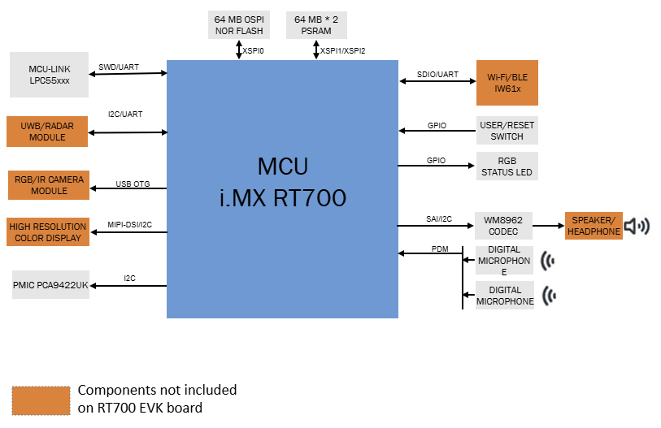
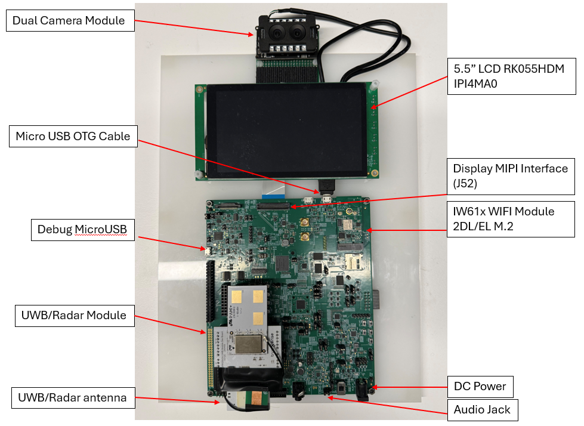

# NXP Application Code Hub
[](https://www.nxp.com)

## AN15042: Building an AI-Powered Smart Doorbell with Face Recognition, UWB Presence Detection, and Real-Time A/V on i.MX RT700

This software accompanies Application Note AN15042 and presents how to implement an AI-powered doorbell on the NXP i.MX RT700 (MIMXRT798S) dual-core Cortex-M33 crossover MCU. It includes features: face recognition, two-way audio/video communication, and UWB/Radar-based presence detection running concurrently, without an external application processor or discrete DSP.

The design runs on the MIMXRT700-EVK (Rev B) using MCUXpresso SDK v26.6.0, and targets developers building residential or commercial access-control products on a cost-effective, single-chip embedded platform.

> **Full Documentation — Application Note AN15042**
> This README provides a quick-start overview. For complete information — including system architecture, detailed hardware assembly, step-by-step build and flash procedures, measured validation results, best practices, and troubleshooting — refer to the full application note:
> **[AN15042 on nxp.com](https://www.nxp.com/docs/en/application-note/AN15042.pdf)**

#### Boards: MIMXRT700-EVK
#### Categories: AI/ML, Vision, Networking, Wireless Connectivity, Graphics, Audio
#### Peripherals: DISPLAY, I2S, SPI, UART, VIDEO, Bluetooth, Wi-Fi, USB, SDIO, CLOCKS, DMA
#### Toolchains: GCC, VS Code

## Table of Contents
1. [Software](#step1)
2. [Hardware](#step2)
3. [Setup](#step3)
4. [Results](#step4)
5. [FAQs](#step5)
6. [Support](#step6)
7. [Release Notes](#step7)

## 1. Software<a name="step1"></a>

- **IDE / Toolchain:** MCUXpresso for VS Code v26.6.57 or later with ARM GNU Toolchain 14.2.Rel1 — install via the VS Code Marketplace extension.
- **SDK:** MCUXpresso SDK v26.6.0 (`release/26.06.00-lts` branch) — https://github.com/nxp-mcuxpresso/mcuxsdk-manifests
- **Other tools:** Python 3.10+, CMake 3.22+, Ninja 1.11+, west 1.2+, Git 2.35+, PuTTY or Tera Term.

For the complete tool list with versions, download links, and SDK import instructions, refer to **[AN15042](https://www.nxp.com/docs/en/application-note/AN15042.pdf)**.

## 2. Hardware<a name="step2"></a>

Required hardware (all must be connected before applying power):

- **MIMXRT700-EVK Rev B** — main processing platform (i.MX RT798S)
- **RGB + IR USB Camera module** (J40) — UVC MJPEG dual-sensor, HM2131 recommended
- **5.5-inch MIPI-DSI LCD** (J52) — NXP RK055HDMIPI4MA0
- **IW61x Wi-Fi Module** (J44) — 802.11 a/b/g/n/ac SDIO, part EAR00422
- **UWB / Radar Module** (Arduino headers J5, J6, J23, J24) — ETNA TS250 DEVKIT
- **5 V DC Power Supply** (J45 barrel connector), **Debug Micro-USB** (J54, 115200 8N1)

### Hardware Connections

The table below lists all required hardware connections with their connector locations, descriptions, and sourcing information. Connect all peripherals before applying power.

| Component | Connector / Location | Description | Source / Link |
|-----------|----------------------|-------------|---------------|
| RT700 EVK Board (Rev B) | Base board | Main processing platform. i.MX RT798S dual Cortex-M33 @ up to 325 MHz. Required: Rev B or later. | [RT700 EVK](https://www.nxp.com/MIMXRT700-EVK) |
| RGB + IR USB Camera module | J40 | UVC-class MJPEG camera with separate RGB and IR sensors. HM2131 sensor recommended. VGA (640x480) resolution minimum. | Standard UVC dual-sensor module (RGB + IR), USB OTG is used. |
| 5.5-inch MIPI-DSI LCD | J52 | Primary user display used for GUI rendering and information presentation. | [NXP RK055HDMIPI4MA0](https://www.nxp.com/part/RK055HDMIPI4MA0) |
| IW61x Wi-Fi Module | J44 | Dual-band 802.11 a/b/g/n/ac Wi-Fi module via SDIO/M.2 interface. | [EAR00422](https://www.mouser.com/en/ProductDetail/Embedded-Artists/EAR00422?qs=P%2FxahI%252BVehmryTBrG%252BqDjA%3D%3D&srsltid=AfmBOooN3fJFnkAuBImZRnLD6mEKB2ojHHhhRudrXmzUV4C6qQ9sBo6I) |
| UWB / Radar Module | Arduino headers J5, J6, J23, J24 | Presence detection and low-power wake-on-approach. | [ETNA TS250 DEVKIT](https://ultrawideband.truesense.it/products/etna-ts-250-devkit/) |
| Digital Microphones (DMIC) | U390/U391, U66/U67 | On-board PDM digital microphones for audio capture. Only 2 units are used. | Built into RT700 EVK |
| WM8962 Audio Codec | U29 | Audio codec for audio output via SAI0. Supports 8 kHz / 16 kHz PCM, 16-bit. Controlled via I2C from Core 0. | Built into RT700 EVK |
| Speaker (Optional) | J29 (3.5 mm audio jack) | Passive speaker for received audio stream output. | Any standard 8-ohm / 1 W speaker (optional accessory) |
| Debug Micro-USB interface | J54 | Programs, debugs, and provides serial console access. Two virtual COM ports are exposed (one for CM33 Core 0 and the other for Core 1). Baud rate: 115200 8N1. | Standard Micro-USB interface |
| 5 V DC Power Supply | J45 (barrel connector) | Primary board power supply. Required: 5 V DC, center positive, minimum 1 A. Short J2 pin 1 & 2 to enable DC power supply. | - |


#### Hardware Rework Notes

The following hardware modifications are required (all apply to RT700 EVK Rev B):

- **UWB/Radar module power:** Solder a wire connection between J23 Pin 5 and JP17 Pin 1.
- **UWB antenna orientation:** The antenna patch on the TS250 DEVKIT must face the same direction as the camera and LCD (front-facing). Reversed orientation causes incorrect ranging and missed presence events.
- **Camera USB enumeration:** If the RGB + IR USB Camera module is not detected, confirm J40 is configured as USB host (use a proper OTG cable with ID pin pulled low).


<p align="center">
  
</p>


<p align="center"><em>Figure 1. Smart Doorbell Hardware Block Diagram</em></p>

<p align="center">
  
</p>

<p align="center"><em>Figure 2. Integrated board with MIMXRT700-EVK, camera, LCD, UWB module, and Wi-Fi module fully assembled.</em></p>

> **Note:** RT700 EVK Rev B requires a hardware rework before first use (UWB power wire J23 Pin 5 to JP17 Pin 1). See **[AN15042](https://www.nxp.com/docs/en/application-note/AN15042.pdf)** for the full hardware connection table, rework notes, and photos.

## 3. Setup<a name="step3"></a>

For the complete step-by-step procedure — SDK manifest setup, project import, build, flash, Wi-Fi configuration, AV controller setup, face enrollment, and UWB firmware update — refer to **[AN15042](https://www.nxp.com/docs/en/application-note/AN15042.pdf)**.

The essential steps to get started are:

### 3.1 Software Environment Setup

Install the following tools on a Windows 10/11 x64 development PC before cloning the SDK or the doorbell project.

1. Install the latest version of **Visual Studio Code** from https://code.visualstudio.com/
2. In VS Code Extensions, search for **"MCUXpresso for VS Code"** and install it. Use the MCUXpresso for VS Code installer for complete installation of all required tools listed in the table below. Detailed instructions: https://mcuxpresso.nxp.com/mcux-vscode/latest/MCUXpresso-Installer.html#installer-overview

| Tool | Version / Notes | How to Obtain |
|------|----------------|---------------|
| ARM GNU Toolchain | 14.2.Rel1 arm-none-eabi or later | Installed automatically by MCUXpresso extension to `~/.mcuxpressotools/` |
| CMake | 3.22 or later | Bundled with MCUXpresso extension, or https://cmake.org/download/ |
| Ninja Build | 1.11 or later | Bundled with MCUXpresso extension, or https://github.com/ninja-build/ninja/releases |
| Python | 3.10 or later | https://www.python.org/downloads/ |
| west (meta-tool) | 1.2 or later | `pip install west` |
| Git | 2.35 or later | https://git-scm.com/ |

### 3.2 Import MCUXpresso SDK

Import an MCUXpresso SDK that supports the RT700 (version 26.06.00 or later). Detailed guide:
https://mcuxpresso.nxp.com/mcux-vscode/latest/Import-Repository.html#import-repository


### 3.3 Import the Smart Doorbell Project

**Recommended — via Application Code Hub:**

1. In the MCUXpresso for VS Code **Quickstart Panel**, select **Application Code Hub**.
2. Use the search filter to enter **"smart doorbell"**. The application will be presented.
3. Enter a unique name and location for the new project.
4. Click **Import Project**. The extension clones the project and imports it into the active workspace.

For detailed Application Code Hub instructions: https://mcuxpresso.nxp.com/mcux-vscode/latest/Application-Code-Hub.html#application-code-hub

**Alternative — via Git:**
```
git clone https://github.com/nxp-appcodehub/an-smart-doorbell-on-rt700.git
```

**Project structure:**
```
an-smart-doorbell-on-rt700/
  core0/      <- CM33 Core 0: face recognition, Wi-Fi, UWB, RTSP, MQTT
  core1/      <- CM33 Core 1: USB host, UVC camera driver
  multicore/  <- Shared RPMSG-Lite definitions
  .vscode/    <- VS Code and MCUXpresso configuration
  license/    <- License files
  flash_debug/  <- Build output (generated by CMake)
```

### 3.4 Associate SDK and Toolchain

**Associate SDK:**
1. Right-click the project in the MCUXpresso panel -> **Config** -> **Associate SDK**.
2. Select the MCUXpresso SDK imported in step 3.2.
3. The extension writes the correct `SdkRootDirPath` into `core0/mcux_include.json`.

**Associate Toolchain:**
1. Right-click the project in the MCUXpresso panel -> **Config** -> **Associate Toolchain**.
2. Select **ARM GNU Toolchain 14.2.Rel1 (arm-none-eabi)**.
3. The toolchain path is saved in `core0/mcux_include.json` under `ARMGCC_DIR`.

### 3.5 Build and Flash

**Build via VS Code (recommended):**
1. Right-click the project in the MCUXpresso panel -> **Config** -> **Set Sysbuild** and confirm sysbuild is enabled.
2. Right-click the project -> **Pristine Build / Rebuild Project**.
3. A successful build produces:
   - `flash_debug/core0/doorbell_cm33_core0.elf`
   - `flash_debug/core1/mimxrt700evk_doorbell_core1.elf`
   - `flash_debug/core1_image.bin` (embedded in Core 0 binary)
4. Connect the board to the PC via J54 (Micro-USB). Confirm DC power (J45) is connected and SW4 is ON.
5. Right-click the project -> **Flash the selected target**. Select **core0** and `doorbell_cm33_core0.elf`.

> **Note:** Always build via sysbuild from the workspace root. Building `core0` alone will fail with a missing `core1_image.bin` linker error.

**Build via command line** (from the project root directory):
```
cmake -S <SDK_root>/mcuxsdk/cmake/extension/sysbuild --preset flash_debug -Dboard=mimxrt700evk -Dcore_id=cm33_core0
cmake --build flash_debug
```

### 3.6 Configure Wi-Fi

Use the Core 0 serial console (115200 8N1) to set Wi-Fi credentials at runtime:
```
wlan_connect_with_password <ssid> <password>
```

### 3.7 Run the Indoor Controller Simulator

Install dependencies and launch the Python controller application:
```
pip install opencv-python pillow
python rtsp_client_V2.4.py
```
Enter `rtsp://<board-IP>:8554` in the RTSP URL field, then click **Play**.

### 3.8 Register a Face

With the LCD backlight ON, press **SW5 (USER1)** on the EVK and hold still in front of the camera for up to 1 second. Face embeddings are stored in RAM and are lost on power cycle; re-enrollment is required after each reboot.

## 4. Results<a name="step4"></a>

**Boot and Connectivity:**
The system boots to face-recognition-ready state within approximately 5 seconds of power-on. Both Core 0 and Core 1 serial consoles confirm successful initialization. Wi-Fi association and IP assignment complete within 10 seconds (triggered via CLI). The assigned IP is printed at the end of the Core 0 boot log.

**Face Recognition:**
Face detection, anti-spoofing, and recognition are validated using the dual RGB + IR camera with the eIQ inference engine on Core 0. The system correctly distinguishes live faces from photographs using IR channel cues. Recognition results (identity, confidence score, landmarks) are displayed on the 5.5-inch MIPI-DSI LCD. Up to 100 face embeddings can be enrolled per session.

**Audio/Video Communication:**
The RTSP/RTP AV session is validated between the RT700 doorbell and the Python controller application on a PC. Video streams at the configured frame rate with latency suitable for real-time interaction. Full-duplex audio operates at 8 kHz or 16 kHz, 16-bit PCM. The controller GUI displays the live video feed with an FPS counter.

**UWB Presence Detection:**
The UWB/Radar module reliably wakes the system when a person enters within approximately 1 meter. The Core 0 console message `>>> UWB init done` confirms successful firmware load and initialization over LPSPI16. State transitions (Sleep -> Face Recognition -> Standby) complete within the expected timeout periods.

## 5. FAQs<a name="step5"></a>

**Q: The camera (J40) is not detected after power-on.**
A: Confirm the USB OTG cable for J40 has the ID pin correctly wired (pulled low). Cables without the ID pin wired prevent USB host enumeration of the dual-sensor camera.

**Q: Build fails with "missing core1_image.bin".**
A: The project must be built using sysbuild from the workspace root, not from inside `core0/`. See the Build Instructions in Section 3.5.

**Q: Face recognition accuracy is low or faces are not recognized.**
A: Ensure enrollment and recognition are performed under diffuse indoor lighting at 0.5 to 1.5 meters. The default recognition confidence threshold is 0.96 and is configurable via the `mpp_app_params_t.recognition_threshold` field in `core0/source/main.c`.

**Q: Face enrollments are lost after power cycle.**
A: Face embeddings are stored in RAM and are erased on every reset. Re-enrollment is required after each reboot. For production deployments, implement persistent storage in external flash or EEPROM.

**Q: The UWB/Radar module does not wake the system.**
A: Verify the hardware rework (J23 Pin 5 to JP17 Pin 1 solder wire) is complete, and confirm the TS250 DEVKIT antenna faces the same direction as the camera and LCD. Check the Core 0 console for `>>> UWB init done` on boot.

## 6. Support<a name="step6"></a>

- **NXP Community Forum** (general MCU technical questions): https://community.nxp.com/
- **MIMXRT700-EVK Product Page**: https://www.nxp.com/MIMXRT700-EVK
- **MCUXpresso for VS Code**: https://nxp.com/mcuxpresso
- **NXP eIQ Machine Learning Software**: https://www.nxp.com/eiq

Questions regarding the content or correctness of this example can be entered as Issues within this GitHub repository.

#### Project Metadata

<!----- Boards ----->
[]()

<!----- Categories ----->
[](https://mcuxpresso.nxp.com/appcodehub?category=aiml)
[](https://mcuxpresso.nxp.com/appcodehub?category=vision)
[](https://mcuxpresso.nxp.com/appcodehub?category=networking)
[](https://mcuxpresso.nxp.com/appcodehub?category=wireless_connectivity)
[](https://mcuxpresso.nxp.com/appcodehub?category=graphics)
[](https://mcuxpresso.nxp.com/appcodehub?category=audio)

<!----- Peripherals ----->
[](https://mcuxpresso.nxp.com/appcodehub?peripheral=display)
[](https://mcuxpresso.nxp.com/appcodehub?peripheral=i2s)
[](https://mcuxpresso.nxp.com/appcodehub?peripheral=spi)
[](https://mcuxpresso.nxp.com/appcodehub?peripheral=uart)
[](https://mcuxpresso.nxp.com/appcodehub?peripheral=video)
[](https://mcuxpresso.nxp.com/appcodehub?peripheral=bluetooth)
[](https://mcuxpresso.nxp.com/appcodehub?peripheral=wifi)
[](https://mcuxpresso.nxp.com/appcodehub?peripheral=usb)
[](https://mcuxpresso.nxp.com/appcodehub?peripheral=sdio)
[](https://mcuxpresso.nxp.com/appcodehub?peripheral=clocks)
[](https://mcuxpresso.nxp.com/appcodehub?peripheral=dma)

<!----- Toolchains ----->
[](https://mcuxpresso.nxp.com/appcodehub?toolchain=gcc)
[](https://mcuxpresso.nxp.com/appcodehub?toolchain=vscode)

Questions regarding the content/correctness of this example can be entered as Issues within this GitHub repository.

>**Note**: For more general technical questions regarding NXP Microcontrollers and the difference in expected functionality, enter your questions on the [NXP Community Forum](https://community.nxp.com/)

[](https://www.youtube.com/NXP_Semiconductors)
[](https://www.linkedin.com/company/nxp-semiconductors)
[](https://www.facebook.com/nxpsemi/)
[](https://x.com/NXP)

## 7. Release Notes<a name="step7"></a>
| Version | Description / Update                           | Date                        |
|:-------:|------------------------------------------------|----------------------------:|
| 1.0     | Initial release on Application Code Hub        | September 29<sup>th</sup> 2026 |

